  

# 🚀 Awesome Agile CRM

  
  
  
  

  <strong>Curated directory of top Agile CRM platforms, visual sales pipeline software, and self-hosted open-source CRM alternatives. 🌟 Star this repo to bookmark it! 🌟</strong>

---

## 📖 Overview & SEO Summary

Welcome to the definitive, community-maintained directory of **Agile CRM software**, **open-source customer relationship management tools**, and **modern sales pipeline solutions**. Whether you are an enterprise RevOps architect comparing **Salesforce** and **HubSpot**, an agile startup seeking cost-effective pipeline software like **Pipedrive** and **Zoho**, or a privacy-first engineering organization looking for top self-hosted open-source CRMs like **Twenty**, **ERPNext**, **Frappe CRM**, or **EspoCRM**, this guide provides structured evaluations, starting price points, free tier thresholds, and GitHub health metrics.

### 🎯 Key Evaluation Pillars
- ⚡ **Agile Pipeline Velocity**: Drag-and-drop Kanban boards, deal stages, activity-based selling, and automated lead routing.
- 🤖 **AI & Agentic Capabilities**: LLM copilots, automated follow-ups, Zia AI, Freddy AI, and Model Context Protocol (MCP) server endpoints.
- 🔒 **Data Sovereignty & Privacy**: Self-hosted Docker containers, MIT/AGPL-licensed stacks, PostgreSQL databases, and on-premise governance.
- 💰 **Transparent Pricing & Free Tiers**: Detailed breakdown of transparent monthly seats, minimum seat commitments, and exact free forever or free trial quotas.

---

## 📑 Table of Contents

- [📊 Sector Overview & Market Dynamics](#-sector-overview--market-dynamics)
- [☁️ SaaS / Hosted Platforms](#️-saas--hosted-platforms)
- [💻 Open-Source GitHub Projects](#-open-source-github-projects)
- [🤝 How to Contribute](#-how-to-contribute)
- [💖 Support](#-support)
- [📈 Star History](#-star-history)
- [⚖️ Disclaimer](#️-disclaimer)

---

## 📊 Sector Overview & Market Dynamics

The global Customer Relationship Management (CRM) market is estimated at approximately **$100–$126 billion in 2025–2026** and is projected to expand past **$150+ billion** before 2030, driven by enterprise digital migration and agentic AI automation. Structurally, the sector exhibits a dual dynamic:
1. **Concentrated Enterprise Oligopoly**: A small tier of heavyweight providers (**Salesforce**, **Microsoft**, **HubSpot**, and **Oracle**) capture the largest share of global enterprise software revenue and dictate enterprise standards.
2. **Dynamic Mid-Market & Open-Source Fragmentation**: The broader landscape remains highly fragmented with thousands of specialized, vertical-specific, and open-source alternatives. Fast-growing product-led teams frequently favor agile, modern platforms (**Twenty**, **Zoho**, **Pipedrive**, **Frappe CRM**) that reduce deployment friction, eliminate seat bloat, and safeguard data sovereignty.

---

## ☁️ SaaS / Hosted Platforms

| 🏢 Product | 📈 Company Scale (Revenue / Valuation) | 💵 Pricing (Starting Paid Tier) | 🎁 Free Tier / Trial Limits | 💡 Key Features & Best For |
| :--- | :--- | :--- | :--- | :--- |
| **Salesforce Sales Cloud** | ~$41.5B Revenue (~$190B Market Cap) | Starter Suite from $25/user/month (annual); Pro Suite $100/user/month; Core $195/user/month | Permanent Free CRM tier up to 2 users (basic contact/lead tracking); or 30-day full-access free trial | Enterprise CRM standard with Agentforce AI, custom workflows, and deep AppExchange integrations. Best for large enterprises requiring custom governance. |
| **HubSpot CRM** | ~$3.13B+ Revenue (~$14B Market Cap) | Sales Hub Starter from $20/seat/month (annual, promotional from $7); Professional $90/seat/month (+$1,500 onboarding) | Permanent free plan with unlimited users (core deal/contact pipelines, ticketing, up to 1M contacts) | Inbound marketing and visual pipeline ecosystem. Best for fast-scaling teams wanting a comprehensive free starting platform. |
| **Zoho CRM** | ~$1.45B–$1.5B Revenue (Bootstrapped / Profitable) | Standard from $14/user/month (annual) or $20 monthly; Professional $23/user/month; Enterprise $40/user/month | Permanent free plan up to 3 users (5,000 records, standard reports, email templates); or 15-day free trial on paid plans | Comprehensive suite with Zia AI, custom modules, and workflow rules. Best for cost-conscious SMBs needing rich functionality. |
| **Monday Sales CRM** | ~$1.23B–$1.37B Revenue (~$3.8B Market Cap) | Basic CRM from $12/seat/month (annual, 3-seat minimum = $36/month); Standard $17/seat/month; Pro $28/seat/month | No permanent free plan; 14-day free trial (unlimited boards, no credit card required) | Work OS-driven CRM with visual boards, deal management, and cross-team workflows. Best for teams already using Monday.com. |
| **Pipedrive** | ~$1.5B Valuation (Acquired by Vista Equity Partners) | Lite plan from $14/user/month (annual) or $24 monthly; Growth $39/user/month | No permanent free plan; 14-day free trial with full feature access (no credit card required) | Pipeline-first visual CRM focused on activity-based selling and deal velocity. Best for SMB sales teams wanting clean deal tracking. |
| **Freshsales** | ~$750M–$1B ARR (~$3.5B Market Cap, Freshworks) | Growth plan from $9/user/month (annual) or $11 monthly; Pro $39/user/month | Permanent free plan up to 3 users (1 deal pipeline, contact lifecycle stages, built-in chat/email); or 21-day free trial of paid tiers | Freddy AI-powered contact scoring, predictive insights, and built-in telephony. Best for SMBs wanting modern AI capabilities. |
| **Copper** | ~$102M Total Funding Raised (Privately held) | Basic from $23/seat/month (annual) or $29 monthly (capped at 2,500 contacts); Professional $59/seat/month | No permanent free plan; 14-day free trial with full Google Workspace integration (no credit card required) | Google Workspace-native CRM embedding directly into Gmail and Google Calendar. Best for teams anchored in Google Workspace. |
| **Insightly** | ~$15M–$37M Est. Annual Revenue (Privately held) | Plus from $29/user/month (annual); Professional $49/user/month; Enterprise $99/user/month | No permanent free plan; 14-day free trial of Plus/Professional tiers (no credit card required) | Combined CRM and project post-sale delivery tracking with workflow automation. Best for professional services and project-driven sales teams. |
| **Close** | ~$13M–$27M Est. Annual Revenue (Bootstrapped/Private) | Solo from $9/user/month (annual, 1 user, 500 AI credits); Essentials $35/user/month (unlimited contacts); Growth $99/user/month | No permanent free plan; 14-day free trial including test calling and SMS credits (no credit card required) | Inside-sales CRM with built-in multi-channel calling, SMS sequences, and power dialers. Best for high-velocity outbound teams. |
| **Capsule CRM** | ~$7M Est. Annual Revenue (Bootstrapped/Private) | Starter from $18/user/month (annual, up to 30,000 contacts); Growth $36/user/month | Permanent free plan up to 2 users, 250 contacts, and 1 sales pipeline; or 14-day free trial of paid plans | Minimalist, relation-focused CRM with contact history and lightweight pipeline automation. Best for micro-businesses and solo entrepreneurs. |

---

## 💻 Open-Source GitHub Projects

The open-source CRM ecosystem has matured significantly. Modern developer-friendly alternatives now deliver real-time GraphQL APIs, extensible custom objects, MCP servers for autonomous AI agents, and modular relational architectures.

Repositories below are sorted in **descending order by GitHub star count**.

### 🌟 Open-Source Repository Ranking

| 📦 Repository | ⭐ GitHub Stars Badge | 📜 License | 🛠️ Tech Stack | 🎯 Focus & Strengths |
| :--- | :--- | :--- | :--- | :--- |
| **Twenty** (`twentyhq/twenty`) |  | AGPL-3.0 | TypeScript, React, Node.js, PostgreSQL | Modern open-source CRM alternative to Salesforce. GraphQL API-first, custom objects/fields, Kanban pipelines, and Docker deployment. |
| **ERPNext** (`frappe/erpnext`) |  | GPL-3.0 | Python, JavaScript, MariaDB | Full enterprise ERP suite with comprehensive built-in CRM module for lead capture, quotation lifecycles, and sales stages. |
| **Monica** (`monicahq/monica`) |  | AGPL-3.0 | PHP (Laravel), Vue.js, MySQL | Personal relationship manager (PRM) designed to document interactions, maintain relationship history, and manage personal/business networks. |
| **Krayin CRM** (`krayin/laravel-crm`) |  | MIT | PHP (Laravel), Vue.js, MySQL | High-performance Laravel CRM with an MIT permissive license, enabling embedding and customizing without copyleft obligations. |
| **Crater** (`crater-invoice/crater`) |  | AGPL-3.0 | PHP (Laravel), Vue.js, MySQL | Open-source invoicing, client payment management, and deal tracking suite for freelancers and SMBs. |
| **Dolibarr** (`Dolibarr/dolibarr`) |  | GPL-3.0 | PHP, JavaScript, MySQL/PostgreSQL | Complete ERP/CRM package tracking leads, commercial proposals, orders, stock, and customer accounts. |
| **SuiteCRM** (`SuiteCRM/SuiteCRM`) |  | AGPL-3.0 | PHP, MySQL/MariaDB | Enterprise-grade fork of SugarCRM featuring mature workflow automation, reporting engines, role security, and portal integration. |
| **Frappe CRM** (`frappe/crm`) |  | AGPL-3.0 | Python (Frappe), Vue 3, TailwindCSS | Lightweight, dedicated sales pipeline CRM by Frappe. Features quick lead triage, omnichannel messaging, and zero ERP overhead. |
| **EspoCRM** (`espocrm/espocrm`) |  | AGPL-3.0 | PHP, Single-Page App (SPA), MySQL | Mature self-hosted CRM featuring granular role-based permissions, entity manager, sales pipelines, LDAP/OIDC auth, and REST API. |
| **Relaticle** (`Relaticle/relaticle`) |  | AGPL-3.0 | PHP (Laravel), PostgreSQL | AI-agent-native CRM with a 32-tool production MCP server, Kanban boards, and human-in-the-loop approvals for autonomous workflows. |
| **YetiForce CRM** (`YetiForceCompany/YetiForceCRM`) |  | YetiForce Public License | PHP, MySQL, JavaScript | Enterprise-ready CRM software with over 80 functional modules, SLA tracking, GDPR compliance, and sales automation. |

---

### 🔍 Detailed Open-Source Project Breakdown

- **Twenty** ([twentyhq/twenty](https://github.com/twentyhq/twenty))   
  *Modern open-source CRM (AGPL-3.0)* — **The highest-health and most popular open-source CRM**, built on a TypeScript/React/Node.js stack with PostgreSQL. Offers custom objects, GraphQL APIs, visual pipeline management, and self-hosted Docker compose recipes. Best for tech startups and developer-led organizations.

- **ERPNext** ([frappe/erpnext](https://github.com/frappe/erpnext))   
  *Enterprise ERP & CRM Suite (GPL-3.0)* — Built on the Frappe framework, ERPNext provides unified lead capture, opportunity tracking, price lists, quotations, and automated billing. Best for companies seeking an all-in-one business management and sales suite.

- **Monica** ([monicahq/monica](https://github.com/monicahq/monica))   
  *Personal Relationship Manager (AGPL-3.0)* — Tailored for tracking interactions, reminders, relationship contexts, and milestones with clients, colleagues, and contacts. Best for consultants and relationship-first professionals.

- **Krayin CRM** ([krayin/laravel-crm](https://github.com/krayin/laravel-crm))   
  *Laravel-based Sales CRM (MIT)* — A fast, customizable CRM built entirely on Laravel and Vue.js. The permissive MIT license allows white-labeling, embedding, and commercial extension without copyleft burdens.

- **Crater** ([crater-invoice/crater](https://github.com/crater-invoice/crater))   
  *Client & Invoice CRM (AGPL-3.0)* — Designed to manage clients, estimates, payments, and pipelines from a unified interface with accompanying iOS/Android apps.

- **Dolibarr** ([Dolibarr/dolibarr](https://github.com/Dolibarr/dolibarr))   
  *Modular ERP/CRM Suite (GPL-3.0)* — Provides rich modular tools including commercial pipeline stages, quotation management, customer catalogs, and billing. Best for established small-to-medium businesses.

- **SuiteCRM** ([SuiteCRM/SuiteCRM](https://github.com/SuiteCRM/SuiteCRM))   
  *Enterprise-Class CRM (AGPL-3.0)* — Mature fork of SugarCRM featuring advanced workflow triggers, case management, role security, and report builders. Best for organizations needing deep enterprise compliance.

- **Frappe CRM** ([frappe/crm](https://github.com/frappe/crm))   
  *Modern Pipeline Sales CRM (AGPL-3.0)* — Dedicated, clean visual CRM built on Vue 3 and Frappe. Delivers instant lead response workflows, multi-channel messaging (email/WhatsApp), and fast Kanban pipeline interactions.

- **EspoCRM** ([espocrm/espocrm](https://github.com/espocrm/espocrm))   
  *Complete CRM with Advanced Admin Controls (AGPL-3.0)* — Clean SPA frontend with PHP backend. Offers entity builders, granular role-based ACLs, LDAP/OIDC authentication, and fast database sync.

- **Relaticle** ([Relaticle/relaticle](https://github.com/Relaticle/relaticle))   
  *AI-Agent MCP CRM (AGPL-3.0)* — Features a production Model Context Protocol (MCP) server with 32 tools, enabling autonomous LLMs (Claude, Cursor, Copilot) to interact with CRM records with human-in-the-loop approvals.

- **YetiForce CRM** ([YetiForceCompany/YetiForceCRM](https://github.com/YetiForceCompany/YetiForceCRM))   
  *Open-Source Enterprise CRM* — Robust CRM system built with enterprise compliance, widgets, security audits, and over 80 integrated business modules.

---

## 🤝 How to Contribute

Contributions are warmly welcomed! Help keep this directory current, accurate, and valuable for the open-source and sales communities:

1. 🍴 Fork the repository.
2. 🌿 Create a new feature branch (`git checkout -b feature/add-new-crm`).
3. 📝 Add your recommended platform following the existing markdown schema (name, scale/stars, starting tier price, free tier limit, and key strengths).
4. ✅ Ensure all URLs are direct and factual.
5. 🚀 Submit a Pull Request with a clear description of why the tool should be added.

---

## 💖 Support

If you found **Awesome Agile CRM** useful or insightful, please consider:
- ⭐ **Starring this repository** on GitHub to help others discover it.
- 🍴 **Forking and sharing** it with your developer, sales, and RevOps networks.
- ☕ **Sponsoring or Buying a Coffee**: Your support helps maintain and update these curated developer resources!
  - 👉 **[Sponsor via GitHub Sponsors Dashboard](https://github.com/sponsors/ishandutta2007)**

Thank you for being part of the open-source community! ❤️

---

## 📈 Star History

---

## ⚖️ Disclaimer

- This repository is a **community-curated directory** intended for research, evaluation, and informational purposes. It is not an endorsement or formal warranty.
- CRM systems process confidential customer and prospect Personally Identifiable Information (PII). When choosing between SaaS and self-hosted open-source software, ensure proper encryption, access control (RBAC), and regulatory compliance (GDPR, CCPA, SOC2, HIPAA).
- Pricing, free tier limits, and feature availability are subject to change by respective vendors and maintainers. Verify directly with official product documentation before making procurement decisions.

---

  Made with ❤️ for sales teams, RevOps engineers, and developers building agile CRM solutions.

